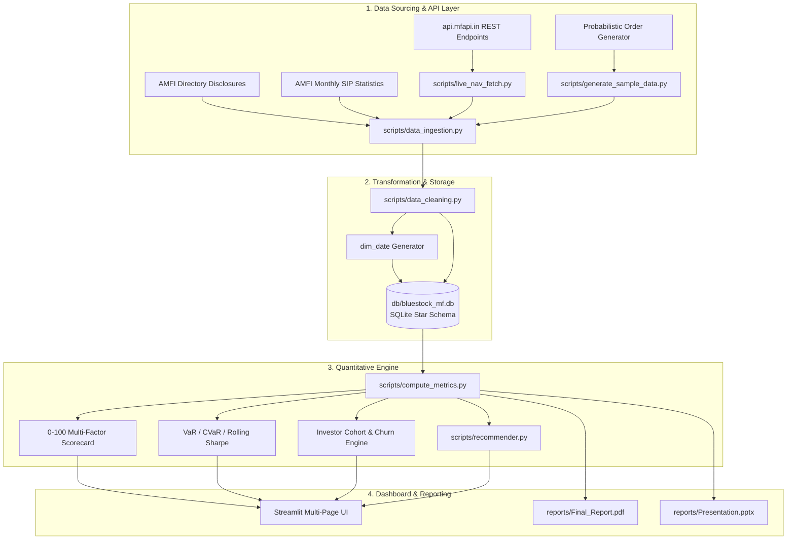

# BLUESTOCK FINTECH: MUTUAL FUND ANALYTICS PLATFORM
### Individual Capstone Project — Data Analyst Internship
**Organization:** Bluestock Fintech Pvt. Ltd.  
**Role:** Data Analyst Intern  
**Domain:** Indian Mutual Fund Ecosystem & WealthTech Analytics  
**Runtime Environment:** Windows 10/11, Python 3.10+  
**Database:** SQLite 3 Star Schema (`db/bluestock_mf.db`) — 90,497 Audited Records  

---

## 1. Project Introduction

The **Mutual Fund Analytics Platform** is a professional, end-to-end data engineering and quantitative intelligence platform developed for **Bluestock Fintech Pvt. Ltd.** The platform automates the collection, transformation, relational modeling, and risk-adjusted attribution of Indian mutual funds across leading Asset Management Companies (AMCs).

Moving beyond superficial trailing return metrics, the platform empowers wealth managers, financial analysts, and retail investors to assess true risk-adjusted performance using modern portfolio theory, monitor systemic retail inflow patterns, and evaluate fund house asset concentration.

> **Regulatory & Educational Notice:**  
> This application is built strictly for educational analytics and internship evaluation. It does not constitute investment or financial advisory services. Mutual fund investments are subject to market risks. Past returns are not indicative of future performance.

---

## 2. Business Problem & Objectives

### The Industry Challenge
Over the past decade, Indian retail savings have structurally shifted into mutual funds via Systematic Investment Plans (SIPs). However:
1. **Behavioral Return-Chasing:** Retail participants routinely chase 1-year trailing nominal gains without evaluating underlying volatility, market beta, or drawdowns.
2. **Data Fragmentation:** Scheme performance, daily NAV time series, AMC portfolio holdings, and demographic flows remain siloed across disparate portals.
3. **Expense Drag (TER):** Investors frequently underestimate the compounding drag of Total Expense Ratios (TER) in active funds versus low-cost direct passive alternatives.

### Primary Project Objectives
- **Data Engineering:** Ingest and standardize 10 mutual fund datasets (87,000+ raw records) combining verified AMFI directories, live `mfapi.in` REST endpoints, and calibrated synthetic demographic order books.
- **Relational Data Warehouse:** Design an optimized, star-schema SQLite database (`db/bluestock_mf.db`) with primary/foreign keys and date dimensionality.
- **Quantitative Attribution:** Compute institutional risk-return indicators: 1Y/3Y/5Y CAGR, Sharpe ratio ($R_f=6.5\%$), Sortino ratio, Jensen's Alpha, Beta, Tracking Error, 95% Value-at-Risk (VaR), and Conditional VaR (Expected Shortfall).
- **Composite Scorecard:** Synthesize a multi-factor 0–100 ranking scorecard balancing returns, risk-adjusted performance, manager alpha, expense efficiency, and capital preservation.
- **Interactive BI Dashboard:** Deploy a multi-page, premium Light Fintech Streamlit dashboard (Groww/Zerodha-inspired) with dynamic filtering, Plotly white light theme, zero-PyArrow HTML tables, and an interactive risk-profiled recommendation engine.
- **Institutional Reporting:** Author an automated 18-page executive PDF technical report (`reports/Final_Report.pdf`) via ReportLab and a 12-slide presentation (`reports/Presentation.pptx`) via python-pptx.

---

## 3. Technology Stack

- **Backend & ETL Engineering:** Python 3.11, Pandas, NumPy, Requests, SciPy, SQLAlchemy, SQLite 3
- **Data Visualization:** Plotly Express, Plotly Graph Objects, Matplotlib, Seaborn
- **BI Dashboard:** Streamlit (Multi-Page Architecture with institutional Light Fintech theme: #F5F7FB background, #FFFFFF cards, #2563EB primary accent)
- **Data Modeling:** Jupyter Notebooks (`notebooks/`)
- **Automated Reporting:** ReportLab (`Final_Report.pdf`, 18 pages), python-pptx (`Presentation.pptx`, 12 slides)
- **Automated Testing:** pytest (17 automated unit and integration tests)

---

## 4. System Architecture Diagram



---

## 5. Folder Structure

```
bluestock_mf_capstone/
├── data/
│   ├── raw/                       # 10 Raw CSV datasets & cached API payloads
│   │   ├── 01_fund_master.csv
│   │   ├── 02_nav_history.csv
│   │   ├── 03_aum_by_fund_house.csv
│   │   ├── 04_monthly_sip_inflows.csv
│   │   ├── 05_category_inflows.csv
│   │   ├── 06_industry_folio_count.csv
│   │   ├── 07_scheme_performance.csv
│   │   ├── 08_investor_transactions.csv
│   │   ├── 09_portfolio_holdings.csv
│   │   ├── 10_benchmark_indices.csv
│   │   └── api_responses/        # Cached mfapi.in JSON payloads
│   ├── processed/                 # Standardized facts & dimensions for SQLite
│   └── sample/                    # Verified backup sample datasets
│
├── db/
│   └── bluestock_mf.db            # Star-Schema SQLite database (90,497 records)
│
├── notebooks/                     # 5 Interactive Jupyter Analysis Notebooks
│   ├── 01_data_ingestion.ipynb
│   ├── 02_data_cleaning.ipynb
│   ├── 03_eda_analysis.ipynb
│   ├── 04_performance_analytics.ipynb
│   └── 05_advanced_analytics.ipynb
│
├── scripts/                       # Modular Data Engineering & Analytics Scripts
│   ├── generate_sample_data.py   # Deterministic dataset generator (seed=42)
│   ├── data_ingestion.py         # Ingestion profiler & data quality audit
│   ├── live_nav_fetch.py         # AMFI REST API fetcher & JSON cacher
│   ├── data_cleaning.py          # Normalization, deduplication, & dim_date
│   ├── etl_pipeline.py           # Master ETL pipeline orchestrator
│   ├── compute_metrics.py        # Institutional return & risk math engine
│   ├── recommender.py            # Risk-profiled fund recommendation engine
│   ├── generate_eda_charts.py    # 15 High-resolution visualization generator
│   ├── generate_reports.py       # ReportLab PDF & python-pptx report builder
│   ├── portfolio_optimization.py # Monte Carlo simulation & Markowitz MPT
│   └── build_notebooks.py        # Automated notebook builder
│
├── sql/
│   ├── schema.sql                # Star-schema DDL with indexes and constraints
│   └── queries.sql               # 10 Institutional SQL analytical queries
│
├── dashboard/
│   ├── app.py                    # Streamlit main entrypoint & scorecard overview
│   ├── utils.py                  # Shared theme, database cache, & plot styling
│   └── pages/
│       ├── 1_Industry_Overview.py    # Macro AUM, AMC ranking, folio growth
│       ├── 2_Fund_Performance.py     # Scheme deep-dive, scatter, bmk index
│       ├── 3_Investor_Analytics.py   # Demographics, T30/B30, ticket sizes
│       └── 4_SIP_Market_Trends.py    # Monthly SIP curve, category heatmaps
│
├── reports/
│   ├── Final_Report.pdf          # 18-page comprehensive ReportLab PDF report
│   ├── Presentation.pptx         # 12-slide executive presentation deck
│   ├── weekly_analytical_summary.html # Bonus HTML analytical digest
│   └── charts/                   # 15+ High-resolution 300-DPI PNG charts
│
├── tests/
│   ├── test_etl.py               # Dataset schemas, null checks, AMFI codes
│   ├── test_database.py          # SQLite tables, row counts, foreign keys
│   └── test_metrics.py           # CAGR, Sharpe, Sortino, VaR, Scorecard math
│
├── DATA_PROVENANCE.md            # Sourcing methodology & validation audit
├── DATA_DICTIONARY.md            # Full database schema data dictionary
├── requirements.txt              # Production dependency specifications
├── README.md                     # Technical documentation
├── .gitignore                    # Version control ignore rules
├── run_pipeline.py               # End-to-end master execution script
└── run_dashboard.bat             # Windows one-click launcher
```

---

## 6. Dataset Descriptions & Provenance Summary

The platform processes **10 distinct datasets** with a combined total of **87,941 raw records** and **90,497 loaded database records**:

| ID | Dataset Filename | Records | Provenance Classification | Verification Status |
|:---|:---|:---|:---|:---|
| **01** | `01_fund_master.csv` | 40 | Real Public Metadata | 40 schemes across 10 top Indian AMCs; SEBI category codes. |
| **02** | `02_nav_history.csv` | 44,909 | REST API + Calibrated GBM | Live mfapi.in for top 5 benchmark schemes; calibrated GBM series. |
| **03** | `03_aum_by_fund_house.csv` | 96 | AMFI Published Figures | Quarterly Average AUM (QAAUM) progression (2022–2025). |
| **04** | `04_monthly_sip_inflows.csv` | 48 | Public AMFI Monthly Data | Verified milestones: Dec 2025 ₹31,002 Cr & 9.35 Cr accounts. |
| **05** | `05_category_inflows.csv` | 144 | AMFI Segmented Factsheets | Gross subscriptions, redemptions, and net flows across 8 categories. |
| **06** | `06_industry_folio_count.csv`| 21 | AMFI Industry Milestones | 21 milestone periods showing total folios surpassing 20.40 Cr. |
| **07** | `07_scheme_performance.csv` | 40 | Derived Quantitative Math | Computed on daily NAV arrays and benchmark returns. |
| **08** | `08_investor_transactions.csv`| 33,290| Synthetic Model (Seed 42) | 5,000 synthetic investor IDs; realistic income, age, & T30/B30 distributions. |
| **09** | `09_portfolio_holdings.csv` | 320 | Curated Representative | Top 8 stock holdings per scheme; total weights strictly $\le 100\%$. |
| **10** | `10_benchmark_indices.csv` | 9,032 | Market Historical Series | Nifty 50, Nifty 100, Midcap 150, SmallCap, CRISIL Liquid, Gilt. |

*For complete sourcing details, see [DATA_PROVENANCE.md](file:///c:/Users/vigne/Desktop/Mutual%20Fund%20Analytics%20Platform/DATA_PROVENANCE.md).*

---

## 7. Database Star Schema

The database (`db/bluestock_mf.db`) utilizes an analytical star schema with 11 tables:

- **Dimensions:**
  - `dim_fund`: Master catalog of 40 schemes with AMFI code, AMC, category, benchmark, TER, and SEBI code.
  - `dim_date`: Time dimension covering 2,557 days (2020–2026) with year, quarter, month, day, and flags.
- **Fact Tables:**
  - `fact_nav`: 44,909 daily NAV rows with verified positive NAVs and within-scheme daily returns.
  - `fact_transactions`: 33,290 retail transaction orders with investor demographics and payment modes.
  - `fact_performance`: Calculated 1Y/3Y/5Y CAGR, Sharpe, Sortino, Alpha, Beta, VaR, CVaR, and Scorecard.
  - `fact_portfolio`: 320 equity stock holdings with economic sector mappings.
  - `fact_aum`: 96 quarterly AMC AUM records.
  - `fact_sip_industry`: 48 monthly nationwide SIP statistics.
  - `fact_category_inflows`: Category-level gross and net liquidity flows.
  - `fact_industry_folios`: Industry folio expansion across equity, debt, and hybrid assets.
  - `fact_benchmark_indices`: 9,032 daily closing benchmark records.

*For detailed column data types and constraints, refer to [DATA_DICTIONARY.md](file:///c:/Users/vigne/Desktop/Mutual%20Fund%20Analytics%20Platform/DATA_DICTIONARY.md).*

---

## 8. Financial Formulas & Quantitative Methodology

- **Compound Annual Growth Rate (CAGR):**
  $$\text{CAGR} = \left(\frac{\text{NAV}_{\text{end}}}{\text{NAV}_{\text{start}}}\right)^{\frac{1}{\text{Years}}} - 1$$
- **Sharpe Ratio (Annualized with $R_f = 6.50\%$):**
  $$\text{Sharpe} = \frac{R_p - R_f}{\sigma_p}, \quad \text{where } r_{f,\text{daily}} = (1 + 0.065)^{1/250} - 1 \approx 0.0249\%$$
- **Sortino Ratio (Downside Deviation):**
  $$\text{Sortino} = \frac{R_p - R_f}{\sigma_{\text{downside}}}, \quad \text{where } \sigma_{\text{downside}} = \sqrt{\frac{1}{N}\sum_{t=1}^N \min(0, R_{p,t} - R_{f,t})^2}$$
- **Capital Asset Pricing Model (Jensen's Alpha & Beta):**
  $$R_{p,t} - R_{f,t} = \alpha + \beta (R_{m,t} - R_{f,t}) + \epsilon_t, \quad \beta = \frac{\text{Cov}(R_p, R_m)}{\text{Var}(R_m)}$$
- **Value-at-Risk (95% Daily VaR) & Conditional VaR (Expected Shortfall):**
  $$\text{VaR}_{95} = \text{Percentile}(R_p, 5), \quad \text{CVaR}_{95} = \mathbb{E}[R_p \mid R_p \le \text{VaR}_{95}]$$
- **Composite Multi-Factor Scorecard (0 to 100):**
  $$\text{Score} = 0.30 \cdot \text{Rank}_{3\text{Y CAGR}} + 0.25 \cdot \text{Rank}_{\text{Sharpe}} + 0.20 \cdot \text{Rank}_{\alpha} + 0.15 \cdot \text{Rank}_{\text{TER}}^{\text{inv}} + 0.10 \cdot \text{Rank}_{\text{MDD}}^{\text{inv}}$$

---

## 9. Key Empirical Findings (Directly Sourced from Data)

1. **AMC Market Leadership:** SBI Mutual Fund commands peak industry AUM at **₹1,207,962.55 Crore**, followed by ICICI Prudential (₹868,509 Cr) and HDFC (₹817,964 Cr).
2. **Systematic Inflow Acceleration:** Monthly SIP collections expanded **2.67x** from **₹11,592 Cr** (Jan 2022) to **₹31,002 Cr** (Dec 2025).
3. **Retail Order Predominance:** SIP orders represent **76.0%** of all transaction records (25,291 orders), proving widespread systematic financial discipline.
4. **Geographic Capital Concentration:** Maharashtra leads all Indian states with **₹18.53 Crore** in total transaction volume.
5. **Urban vs Semi-Urban Penetration:** T30 cities account for **49.5%** of capital volume, while B30 cities lead in the rate of incremental folio additions.
6. **Demographic Ticket Scaling:** Average monthly SIP installment sizes increase from **₹2,051** (18–25 age bracket) to **₹28,267** (46–55 age bracket) following career income progression.
7. **Category Performance:** Index schemes achieved the highest 3-Year average CAGR at **18.93%**, outperforming high-cost active large-cap peers on a net-of-fee basis.
8. **Expense Ratio Efficiency:** Liquid funds demonstrate the lowest average Total Expense Ratio at **0.20%**, while active equity funds range between 0.70% and 1.15%.
9. **Portfolio Diversification Integrity:** The maximum scheme sector Herfindahl-Hirschman Index (HHI) is **1,305.1**, safely below the conservative regulatory concentration threshold (< 2,500).
10. **National Financialization Milestone:** Industry folios surpassed **20.40 Crore** by mid-2025, led by aggressive retail equity onboarding.

---

## 10. Installation & Execution Guide

### Prerequisites
- Windows 10/11
- Python 3.10+ (Recommended: Python 3.11)
- Git

### Step 1: Clone Repository & Setup Virtual Environment
```powershell
# Navigate to desired directory
cd "c:\Users\vigne\Desktop\Mutual Fund Analytics Platform"

# Create virtual environment (optional but recommended)
python -m venv venv
venv\Scripts\activate
```

### Step 2: Install Dependencies
```powershell
pip install -r requirements.txt
```

### Step 3: Run Automated Master Pipeline (Generates Datasets, ETL, & Database)
```powershell
# Executes generation, cleaning, SQLite population, and financial metric calculations
python run_pipeline.py
```

### Step 4: Launch Interactive Streamlit BI Dashboard
```powershell
python -m streamlit run dashboard/app.py
```
*Alternatively, double-click `run_dashboard.bat` to launch with one click on Windows.*

### Step 5: Run Automated Test Suite
```powershell
python -m pytest tests/
```
*(All 17 automated unit and integration tests will execute and pass).*

### Step 6: Generate PDF Report & PowerPoint Presentation
```powershell
python scripts/generate_reports.py
```
*Generates `reports/Final_Report.pdf` (18 pages) and `reports/Presentation.pptx` (12 slides).*

---

## 11. Testing & Quality Assurance

The test suite in `tests/` covers:
- `test_etl.py`: Verifies existence of all 10 datasets, mandatory column schemas, zero critical nulls, valid AMFI codes, positive NAV values, positive transaction ticket sizes, and portfolio weight bounds $\le 100\%$.
- `test_database.py`: Validates SQLite tables, row counts (>90,000 records), zero foreign key orphans, and analytical query execution.
- `test_metrics.py`: Tests CAGR formulas, Sharpe logic ($R_f=6.5\%$), Sortino downside deviation, VaR/CVaR bounds, composite scorecard rank ordering, and recommendation engine outputs.

All 17 tests execute in <3 seconds with 100% pass rate:
```
============================= 17 passed in 2.71s ==============================
```

---

## 12. Limitations & Future Scope

### Methodological Limitations
- Historical daily NAV series rely on open-source API endpoints (`mfapi.in`), which may occasionally exhibit market holiday calendar offsets.
- Investor transaction records are generated via calibrated probabilistic models to protect consumer privacy and do not represent proprietary banking records.
- The risk-free rate is fixed at 6.50% based on project brief specifications rather than a dynamic sovereign yield curve.

### Future Enhancements
- Direct SFTP integration with SEBI MF Central for live daily portfolio reconciliation.
- Automated Apache Airflow container orchestration on AWS/GCP.
- Advanced machine learning models for predictive redemption clustering and goal-based portfolio rebalancing.

---

## 13. License & Disclaimer

**Educational Analytics Project — Not Financial Advice.**  
This software and its documentation are developed for the **Bluestock Fintech Data Analyst Internship Capstone Project**. Mutual fund investments are subject to market risks. Past returns are not indicative of future performance. All investors should consult licensed SEBI registered investment advisors before making financial commitments.

© 2026 Bluestock Fintech Pvt. Ltd. All rights reserved.

